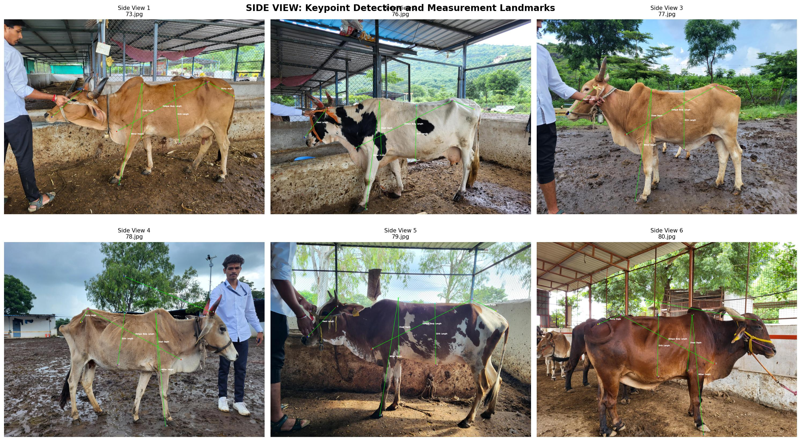
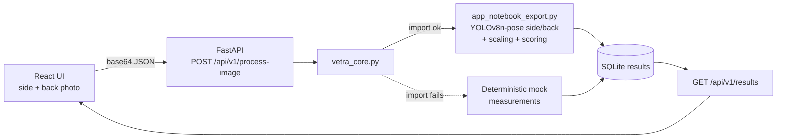
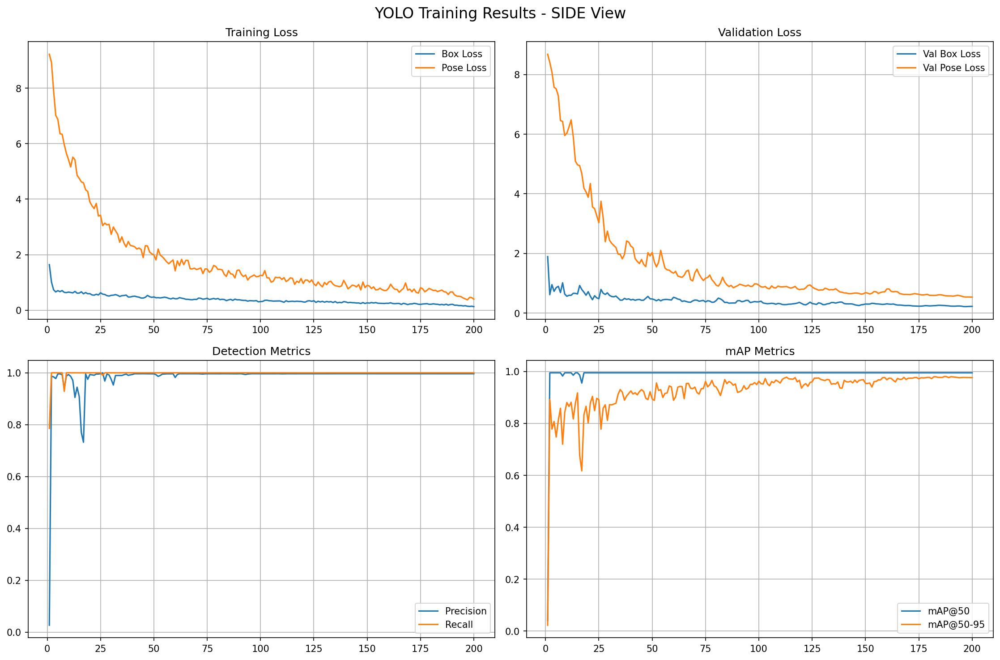
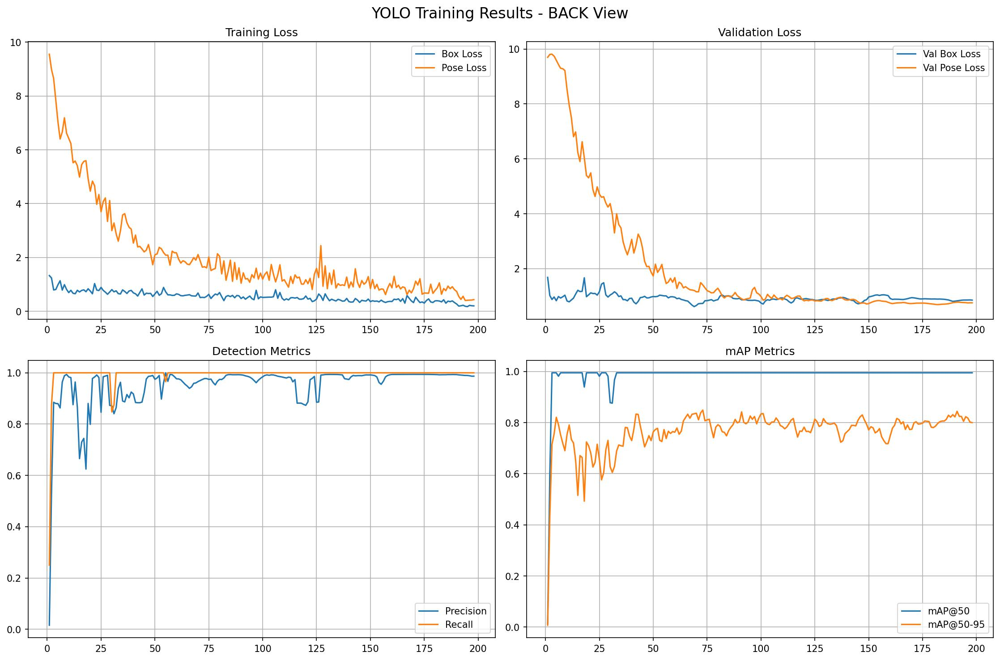
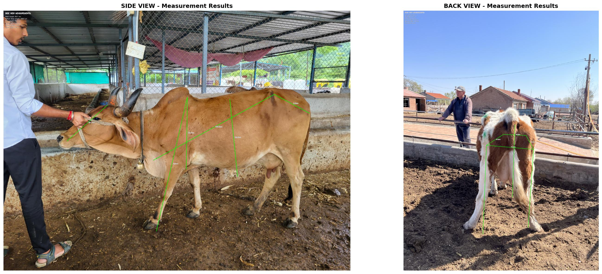
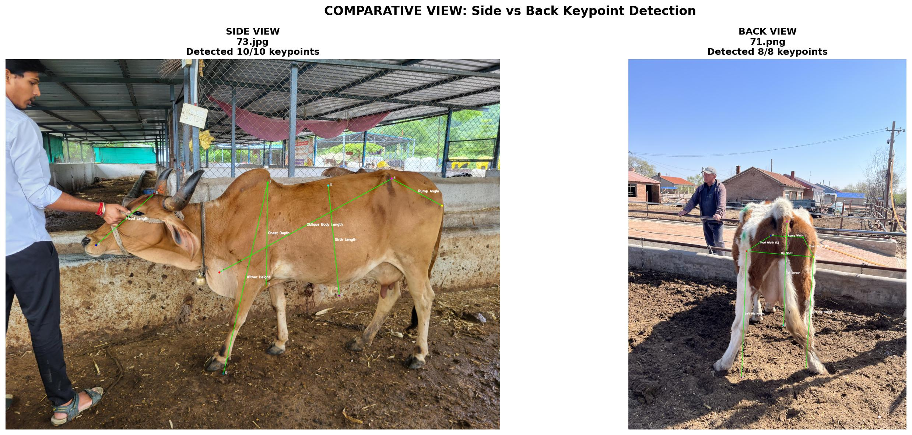
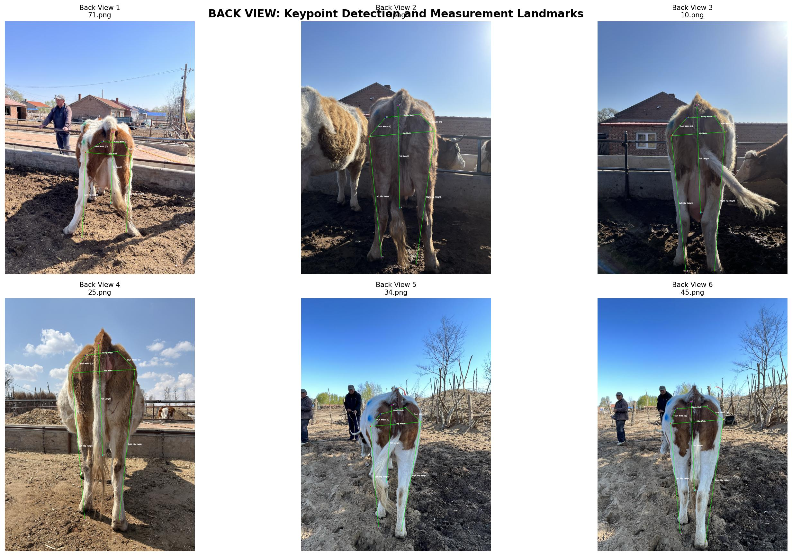

# VETRA v2.2 — Pose models plus a first web app

The **VETRA (Vision-Enabled Type Recording Assistant)** v2 pipeline, retrained (side 10 kp and back 8 kp YOLOv8n-pose), with a first full-stack integration: a **FastAPI** backend that imports the exported notebook pipeline and a **React + Vite** UI that uploads side and back photos and shows the extracted traits.


<p align="center">
  
</p>

> [!NOTE]
> **Archived.** This was the first attempt at serving VETRA models through an API. The final models are in [VETRA-v3.0](https://github.com/rupeshbharambe24/VETRA-v3.0), and the production system is [VETRA---App](https://github.com/rupeshbharambe24/VETRA---App).

## Contents

- [Overview](#overview)
- [What's new in this version](#whats-new-in-this-version)
- [Architecture](#architecture)
- [Results](#results)
- [Caveats](#caveats)
- [Project structure](#project-structure)
- [Getting started](#getting-started)
- [Dataset](#dataset)
- [VETRA project map](#vetra-project-map)
- [License](#license)

## Overview

**Problem.** Linear type traits of cattle and buffalo (body length, withers height, girth, rump and hip dimensions) are scored by hand for breeding programmes (SIH 2025, NDDB / Rashtriya Gokul Mission context). VETRA estimates them from two smartphone photos.

**Approach.** Two pose models (side 10 kp, back 8 kp) feed keypoint distances through per-measurement pixel-to-cm factors. The resulting measurements go into trait scoring and a prototype type/breed classifier. In v2.2 the pipeline is also exported to a Python module and exposed through `POST /api/v1/process-image`.

**Highlights**
- Retrained pose models with full Ultralytics run folders, including `weights/best.pt` for both views.
- FastAPI backend (`App/backend`) with a pydantic request/response schema, SQLite result storage and a `GET /api/v1/results` history endpoint.
- React + TypeScript + shadcn/ui front end (`App/frontend`) with side/back image upload, a results view and info pages (schemes, insurance, helpline).
- `App/run_app.py` starts the backend and the front end together.

## What's new in this version

Changes since [VETRA-v2.0](https://github.com/rupeshbharambe24/VETRA-v2.0):

- **Retrained models with real artefacts.** v2.0's weights and run files were lost as un-uploaded Git LFS pointers. Here they are committed normally. Side-view data now has 138 matched image/label pairs (v2.0 had 137).
- **First app integration (`App/`).** The main notebook was exported to `App/backend/app/models/app_notebook_export.py` and wrapped by `vetra_core.py`, which calls `final_measurement_pipeline` / `complete_vetra_pipeline` from the notebook code.
- **Sample images** in `assets/samples/` for trying the pipeline.
- The notebook code itself barely changed: the only source diff from v2.0 is the list of back-view images chosen for visualisation.

## Architecture



<details>
<summary>API endpoints</summary>

| Method | Path | Body / response |
|---|---|---|
| `GET` | `/` | health check |
| `POST` | `/api/v1/process-image` | `{sideImageData, backImageData?, animalType?, notes?}` (base64 images) → body length, withers height, girth, body score, estimated weight, confidence, raw measurements, classification |
| `GET` | `/api/v1/results` | list of stored results |

Interactive docs: `http://localhost:8000/docs`.

</details>

## Results

Numbers come from the outputs saved in `notebooks/model.ipynb` (RTX 3050 Ti Laptop GPU, Ultralytics 8.3.203).

| Model | Data (train / val / test) | Epochs | Val box mAP50 / 50-95 | Val pose mAP50 / 50-95 | Test box mAP50 / 50-95 |
|---|---|---|---|---|---|
| Side view, 10 kp | 96 / 14 / 28 | 200 | 0.995 / 0.975 | 0.995 / 0.928 | 0.995 / 0.957 |
| Back view, 8 kp | 49 / 8 / 15 | 198 (early stop) | 0.995 / 0.810 | 0.995 / 0.855 | 0.995 / 0.816 |

Step 1.9 prints the test-split values under the labels "Precision"/"Recall", but they are box mAP50/mAP50-95. One back-view test image (`50.jpg`) was skipped as corrupt. Validation sets are tiny (14 and 8 images).

| Side training | Back training |
|---|---|
|  |  |

<details>
<summary>Measurement and comparative visualisations</summary>





</details>

- Calibrated global scale in this run: **0.0819 cm/px**. Per-view scaling data is in `results/scaling_calibration_data.csv` (83 images, pixel lengths for all 12 measurements).
- The notebook's plausibility check (values inside biologically sensible ranges, *not* agreement with tape measurements) passed 4/6 side and 3/6 back measurements on its test pair.

## Caveats

- **The type/breed classifier is trained on synthetic data**, generated from hand-picked normal distributions. On that synthetic data it reaches 0.940 test / 0.947 CV for animal type and 0.833 / 0.767 for cattle / buffalo breed. The demo cells display a floored "demo accuracy" (`max(accuracy, 0.91)`) and some hard-coded headline figures. Don't quote those.
- **The app can silently run in mock mode.** `vetra_core.py` imports the exported notebook. If that import fails (missing heavy dependencies such as TensorFlow, or relative paths not resolving from `App/backend`), it returns deterministic mock values with breed `"mock-breed"`. The SQLite database committed earlier (now removed) held one such mock result. Check the backend log for `using mock pipeline` before trusting outputs.
- The exported module runs the whole notebook at import time, including dataset checks. This was a hackathon integration shortcut, and VETRA---App replaced it with a proper service layer.

## Project structure

```text
VETRA-v2.2-with-app/
├── notebooks/
│   ├── model.ipynb                 # main pipeline (split, train, visualise, measure, classify, integrate)
│   ├── model-demo.ipynb            # presentation copy (same as v2.0's demo notebook)
│   ├── kpt-vis-and-analysis.ipynb  # keypoint visualisation (Step 2 standalone)
│   └── measurement-extraction.ipynb
├── configs/                        # side_view.yaml (10 kp), back_view.yaml (8 kp)
├── models/pretrained/              # yolov8n-pose.pt (+ yolo11n.pt from Ultralytics AMP check)
├── runs/
│   ├── side_view/yolov8_cow_side_v1/   # incl. weights/best.pt
│   └── back_view/yolov8_cow_back_v1/   # incl. weights/best.pt
├── results/
│   ├── figures/                    # training curves and visualisations
│   ├── scaling_calibration_data.csv
│   └── enhanced_bpa_output.json    # example end-to-end record
├── assets/samples/                 # 8 sample cattle images
├── App/
│   ├── backend/                    # FastAPI app (app/main.py, api/v1, services, models/vetra_core.py)
│   ├── frontend/                   # React + Vite + TypeScript + shadcn/ui
│   └── run_app.py                  # starts backend (:8000) and frontend (:8080)
├── requirements.txt                # notebook dependencies
└── LICENSE
```

## Getting started

**Notebooks**

```bash
git clone https://github.com/rupeshbharambe24/VETRA-v2.2-with-app.git
cd VETRA-v2.2-with-app
python -m venv .venv && source .venv/bin/activate
pip install -r requirements.txt
jupyter notebook notebooks/model.ipynb
```

Datasets are not committed. Training expects `data/side_view`, `data/labels_side`, `data/back_view` and `data/labels-back` (Step 1.2). Inference cells use the committed `runs/*/weights/best.pt`.

**Pose inference only**

```python
from ultralytics import YOLO

side = YOLO("runs/side_view/yolov8_cow_side_v1/weights/best.pt")
kpts = side.predict("assets/samples/22.png", imgsz=640)[0].keypoints.xy   # (1, 10, 2)
```

**Web app** (Python 3.11, Node 18+)

```bash
pip install -r App/backend/requirements.txt
cd App/frontend && cp .env.example .env && npm install && cd ..
python run_app.py        # backend http://localhost:8000/docs, frontend http://localhost:8080
```

## Dataset

Side view: 138 images with 10-keypoint labels. Back view: 72 images with 8-keypoint labels. Neither is committed. Provenance isn't documented. The figures suggest a mix of team-collected farm photos (with identifiable people) and photos that look like they come from a public cattle-measurement dataset, so **the licence is unclear**. The 8 images in `assets/samples/` come from the same pool.

## VETRA project map

VETRA (SIH 2025, Grand Finale Top 5) is split across several repositories. ML work evolved v1.1 → v2.0 → v2.2 → v3.0; the apps below consume or capture data for those models.

| Repository | What it is | Stack | Status |
|---|---|---|---|
| [VETRA-v1.1](https://github.com/rupeshbharambe24/VETRA-v1.1) | First ML experiment: 6-keypoint YOLOv8n-pose on side-view cow images + regressors mapping keypoint distances to body measurements (cm) | Python, YOLOv8-pose, scikit-learn | Archived (ML) |
| [VETRA-v2.0](https://github.com/rupeshbharambe24/VETRA-v2.0) | Separate side (10 kp) and back (8 kp) YOLOv8n-pose models, per-measurement pixel-to-cm scaling, measurement extraction, prototype type/breed scoring | Python, Ultralytics | Archived (ML) |
| **[VETRA-v2.2-with-app](https://github.com/rupeshbharambe24/VETRA-v2.2-with-app)** (this repo) | v2 pipeline retrained and wrapped in a first FastAPI backend + React UI (`/api/v1/process-image`) | Python, FastAPI, React | Archived (ML + app) |
| [VETRA-v3.0](https://github.com/rupeshbharambe24/VETRA-v3.0) | Final training: side (14 kp), back (10 kp) and udder-bottom (8 kp) YOLOv8n-pose models, udder U-Net + ResNet18, ArUco scaling, dataset tooling | Python, Ultralytics, PyTorch | Final models |
| [VETRA---App](https://github.com/rupeshbharambe24/VETRA---App) | Final system: FastAPI backend serving the v3.0 pose models + udder U-Net/ResNet18, NDDB-style trait scoring, React web UI | FastAPI, PyTorch, React + Vite | Final (SIH 2025 finale) |
| [vetra-main-app-latest-v3](https://github.com/rupeshbharambe24/vetra-main-app-latest-v3) | Flutter field app: capture protocol, offline SQLite records, PDF reports (not yet wired to the analysis API) | Flutter, Riverpod, SQLite | Prototype |
| [vetra-depth-recorder-latest-v3](https://github.com/rupeshbharambe24/vetra-depth-recorder-latest-v3) | RGB + ARCore depth capture with intrinsics, pose and ZIP export | Flutter, Kotlin, ARCore | Prototype |
| [VETRA---Depth-Recorder](https://github.com/rupeshbharambe24/VETRA---Depth-Recorder) | Earlier capture app: RGB frames + phone-sensor pose metadata (no real depth) | Expo / React Native, TypeScript | Superseded |
| [vetra-pashu-scan](https://github.com/rupeshbharambe24/vetra-pashu-scan) | Early Lovable-generated PWA UI; Supabase edge functions return mock measurements | Vite, React, Supabase | Superseded (UI prototype) |
| [pashudhan-ui](https://github.com/rupeshbharambe24/pashudhan-ui) | Fork of a teammate's Lovable UI prototype (landing page + mock prediction page) | Vite, React | Fork |

## Acknowledgements

Built by **Rupesh Bharambe** for the VETRA team at Smart India Hackathon 2025. The front end was bootstrapped with Lovable (shadcn/ui), and pose estimation uses [Ultralytics YOLOv8](https://github.com/ultralytics/ultralytics).

## License

Code is released under the [MIT License](LICENSE). Images and measurement data are not covered by it.
